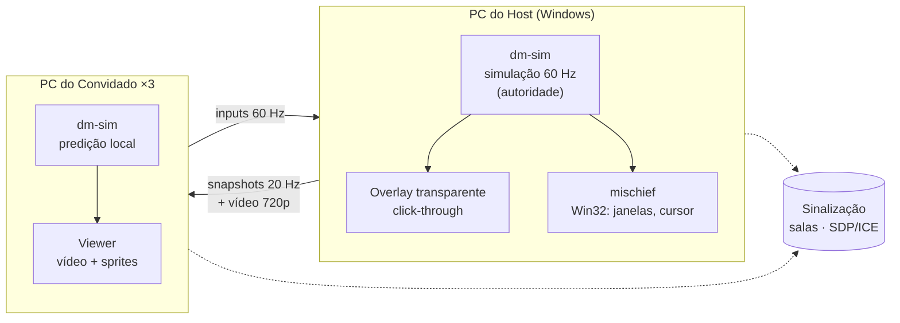

<div align="center">


# Better Together

**Seus amigos, como bichinhos, passeando pelo seu desktop.**

Um app para Windows no estilo *Desktop Goose*, só que multiplayer: até 4 amigos
dividem a área de trabalho do Host, bagunçam janelas, mandam emotes e conversam.

[](https://github.com/TamyDB/better-together/actions/workflows/ci.yml)


[O jogo](#-o-jogo) · [Instalação](#-instalação) · [Detalhes técnicos](#-detalhes-técnicos) · [Roadmap](#-roadmap)

</div>

<!-- TODO: substituir por um GIF do pato vagando sobre o desktop quando houver build no Windows -->

---

## 🦆 O jogo

Uma pessoa abre uma **sala** e vira o **Host**. Os amigos entram com o código da sala
(algo como `PATO-4821`) e aparecem como bichinhos **andando por cima da área de trabalho
dela**, por cima das janelas, ícones e barra de tarefas. Cada amigo vê a tela do Host
ao vivo e controla o próprio bichinho pelo teclado.

### Escolha seu bicho

| | Animal | |
|:---:|:---|:---|
| 🦆 | **Pato** | o clássico encrenqueiro |
| 🌿 | **Capivara** | zen até a página dois |
| 🐴 | **Cavalo** | grande demais para a barra de tarefas |
| 🐔 | **Galinha** | caos em forma de penas |

Cada animal só pode ser escolhido uma vez por sala. São no máximo 4 jogadores: o Host
e mais 3 amigos.

### O que dá para fazer

- **Passear e correr** pelo desktop do Host.
- **Emotes e chat** com a turma.
- **Travessuras leves**, no espírito do ganso:
  - 🪟 **arrastar janelas** pela barra de título;
  - 🖱️ **puxar o cursor** do Host por alguns segundos;
  - 🐾 **deixar coisas na tela**: pegadas, bilhetinhos e figurinhas que somem sozinhos.

### O Host está no controle

O desktop é de quem hospeda, então ninguém clica nem digita nos apps do Host. Só existem
as travessuras acima, e todas têm limite de tempo e de quantidade. O Host pode:

- desligar cada travessura, para todos ou para um jogador só;
- expulsar jogadores e trancar a sala;
- apertar o **botão de pânico** (`Ctrl+Alt+F12`), que congela tudo na hora.

Os convidados nunca recebem títulos de janelas nem nomes de programas do Host.

> [!NOTE]
> **Estado atual: marco M2 (rede).** A implementação está pronta, mas ainda não foi
> validada ponta a ponta em janelas reais (nem no Windows). Dá para criar uma sala, entrar
> com o código, escolher o animal e ver os bichinhos de todos se mexendo. O vídeo da tela
> do Host chega no M3: por enquanto o convidado vê um painel escuro com um aviso, com os
> bichinhos por cima. Vídeo, chat e travessuras chegam nos próximos marcos (veja o
> [Roadmap](#-roadmap)).

---

## 📦 Instalação

> [!IMPORTANT]
> Ainda não existe instalador pronto, que chega no marco M6. Por enquanto, o app é
> compilado a partir do código-fonte.

### Pré-requisitos

| Ferramenta | Versão | Observação |
|:---|:---|:---|
| [Rust](https://rustup.rs) | stable | com `rustfmt` e `clippy` |
| [Node.js](https://nodejs.org) | 22+ | |
| [pnpm](https://pnpm.io) | 12+ | |
| WebView2 | — | já vem no Windows 10/11 atualizado |

<details>
<summary><b>Desenvolvendo no Linux?</b> Dependências de sistema do Tauri</summary>

<br />

O app é feito para Windows, mas a simulação, os testes e o **modo dev** rodam no Linux.

> [!WARNING]
> O WebKitGTK não tem WebRTC. No Linux só dá para testar a sinalização e as telas até a
> conexão: ao entrar numa sala, o erro esperado é "Não foi possível iniciar a conexão com o
> Host". Jogar de verdade exige o WebView2, em uma VM ou um PC com Windows.

**Fedora**
```sh
sudo dnf install webkit2gtk4.1-devel libsoup3-devel javascriptcoregtk4.1-devel \
  librsvg2-devel rustfmt clippy
```

**Ubuntu / Debian**
```sh
sudo apt install libwebkit2gtk-4.1-dev libsoup-3.0-dev libjavascriptcoregtk-4.1-dev \
  librsvg2-dev libayatana-appindicator3-dev
```

</details>

### Rodando

```sh
git clone git@github.com:TamyDB/better-together.git
cd better-together
pnpm --dir app install

# Windows: overlay transparente por cima do desktop
pnpm --dir app tauri dev

# Linux/dev: janela comum 1280×720, focável
DM_DEV_WINDOW=1 pnpm --dir app tauri dev
```

Para gerar o executável, sem instalador, rode `pnpm --dir app tauri build --no-bundle`.

### Jogando com amigos

Ainda não existe servidor público (ele chega no M6). Para jogar, alguém precisa subir a
**sinalização**, o servidor leve que cria as salas e apresenta os PCs uns aos outros. Depois
disso o jogo em si é P2P.

Para gerar o executável de dev, rode `pnpm --dir app tauri build --debug --no-bundle`
(sai em `target/debug/`). Sem `--debug`, o executável sai em `target/release/`.

**Sinalização** (escolha uma das alternativas):

```sh
# Linux/bash: só nesta máquina (padrão 127.0.0.1:8787)
cargo run -p dm-signaling

# Linux/bash: aberta para a rede
BT_SIGNALING_ADDR=0.0.0.0:8787 cargo run -p dm-signaling
```

```powershell
# PowerShell: aberta para a rede
$env:BT_SIGNALING_ADDR="0.0.0.0:8787"; cargo run -p dm-signaling
```

> [!WARNING]
> `0.0.0.0` expõe a sinalização na rede em `ws://`, **sem TLS**, e pede liberação no
> firewall. Use só com amigos.

**App** (Host e convidados), apontando para a sinalização:

```sh
# Linux/bash
BT_SIGNALING_URL=ws://meu-servidor:8787/ws ./target/debug/better-together
```

```powershell
# PowerShell
$env:BT_SIGNALING_URL="ws://meu-servidor:8787/ws"; .\target\debug\better-together.exe
```

| Variável | Onde | Padrão |
|:---|:---|:---|
| `BT_SIGNALING_ADDR` | sinalização | `127.0.0.1:8787` |
| `BT_SIGNALING_URL` | app | `ws://127.0.0.1:8787/ws` |
| `BT_TURN_URL`, `BT_TURN_USER`, `BT_TURN_PASS` | app | desligado (só STUN) |

O TURN só é usado se as **três** variáveis estiverem definidas.

**Testando sozinho, com dois executáveis** (3 terminais PowerShell, na mesma máquina). O teste
ponta a ponta exige o WebView2, então precisa de uma VM ou um PC com Windows, e o build também
é feito lá: `pnpm --dir app tauri build --debug --no-bundle`.

1. `cargo run -p dm-signaling`
2. Host: `.\target\debug\better-together.exe`, com nome, animal e "Criar sala".
3. Convidado: `.\target\debug\better-together.exe`, com o código da sala; depois escolha um
   animal livre no lobby.

O roteiro completo de teste manual está em [`docs/e2e-m2.md`](docs/e2e-m2.md).

Pela internet, o Host e os convidados precisam alcançar a sinalização, então ela tem que
ser hospedada por alguém (uma VPS, ou uma porta liberada no roteador). O código da sala
(como `PATO-4821`) vale **enquanto o Host estiver conectado**: se o Host sair, a sala some.
A sala depende da conexão do Host com a sinalização: se ela cair, novos amigos não entram,
mas quem já está na sala segue conectado. Se a rede de alguém bloquear a conexão direta,
será preciso um servidor TURN próprio.

### Controles

| Tecla | Ação |
|:---|:---|
| <kbd>Ctrl</kbd> + <kbd>Shift</kbd> + <kbd>P</kbd> | liga/desliga o **modo bichinho** |
| <kbd>W</kbd> <kbd>A</kbd> <kbd>S</kbd> <kbd>D</kbd> | andar |
| <kbd>Shift</kbd> | correr |
| <kbd>Esc</kbd> | sair do modo bichinho |
| Ícone na bandeja | alternar o modo / sair do app |

Fora do modo bichinho, o teclado funciona normalmente e o bichinho vagueia sozinho.
Atalhos com <kbd>Ctrl</kbd>, <kbd>Alt</kbd> ou <kbd>Win</kbd> sempre chegam ao Windows.

---

## 🛠 Detalhes técnicos

### Arquitetura



- **O Host é a autoridade.** Ele simula o mundo e os convidados mandam só *inputs*.
  Cada convidado prevê o próprio bichinho e se corrige quando chega um snapshot.
- **Os bichinhos não vão fazer parte do vídeo.** Com o vídeo do M3, a overlay do Host vai
  ficar fora da captura (`WDA_EXCLUDEFROMCAPTURE`), e cada convidado vai desenhar os sprites
  por cima do vídeo, então eles continuam nítidos e respondem rápido.
- **Rede P2P em estrela** via WebRTC, com um servidor leve só para criar as salas e
  um TURN de reserva para quando a conexão direta falhar.

### Stack

| Camada | Tecnologia |
|:---|:---|
| Núcleo, regras, Win32 | Rust · [`windows`](https://crates.io/crates/windows) |
| App e janelas | [Tauri 2](https://tauri.app) |
| UI, render, WebRTC | TypeScript · Vite · Canvas 2D · WebView2 |
| Protocolo | `serde` + `bincode` |
| Testes | `cargo test` · `proptest` · Vitest |

<details>
<summary><b>Estrutura do repositório</b></summary>

<br />

```
crates/
  protocol/     tipos, mensagens, codec bincode, versão do protocolo
  signaling/    servidor de sinalização (axum): salas e troca de SDP/ICE
  sim/          simulação pura e determinística (sem I/O, relógio ou RNG global)
app/
  src-tauri/    app Tauri: loop da sim, overlay, modo bichinho, hook de teclado, bandeja
  ui/           TypeScript: render dos bichinhos em canvas
docs/superpowers/
  specs/        spec de design
  plans/        planos de implementação por marco
```

</details>

<details>
<summary><b>Decisões de projeto que valem conhecer</b></summary>

<br />

- **Coordenadas normalizadas** em `[0,1]` do monitor primário do Host. Funcionam em
  qualquer resolução e escala de DPI. A velocidade é medida em alturas de tela por
  segundo, então o movimento é igual em telas 16:9, 21:9 ou verticais.
- **Timestep fixo** de 60 Hz, com no máximo 5 ticks de recuperação. Depois de uma
  travada, o bichinho não se teletransporta.
- **Input que para de chegar** expira em 30 ticks (0,5 s). Uma tecla "presa" por
  evento perdido não faz o bichinho andar para sempre.
- **Hook de teclado (`WH_KEYBOARD_LL`)** só engole WASD/Esc com o modo ligado e sem
  modificadores. Ele só engole o soltar de uma tecla se também engoliu o apertar, e
  nunca engole o Shift, para nenhuma tecla ficar presa no sistema.

</details>

### Testes

```sh
cargo test --workspace                              # protocolo, simulação, sinalização, app
cargo clippy --workspace --all-targets -- -D warnings
pnpm --dir app test                                 # render (Vitest)
```

A CI roda os testes Rust e o clippy no **Ubuntu** e no **Windows**, onde também faz o build
do app. `cargo fmt`, `tsc` e o Vitest rodam só no Ubuntu.

### Documentação

- 📐 [Spec de design](docs/superpowers/specs/2026-11-05-desktop-multiplayer-design.md)
- 🗺️ [Plano do M1](docs/superpowers/plans/2026-11-05-m1-fundacao.md)
- 🗺️ [Plano do M2](docs/superpowers/plans/2026-11-06-m2-rede.md)

---

## 🗺 Roadmap

| Marco | Conteúdo | Status |
|:---:|:---|:---:|
| **M1** | Fundação: protocolo, simulação, overlay, modo bichinho | ✅ |
| **M2** | Rede: salas, WebRTC, lobby com escolha de animal, 4 bichinhos | 🧪 implementado, E2E manual pendente |
| **M3** | Vídeo: stream da tela do Host para os convidados | ⏳ |
| **M4** | Social: chat e emotes | ⏳ |
| **M5** | Travessuras, painel de permissões e botão de pânico | ⏳ |
| **M6** | Distribuição: instalador, auto-update, servidor de salas | ⏳ |

<div align="center">
<br />
<sub>Feito com 🦆 e Rust · <a href="LICENSE">licença MIT</a></sub>
</div>
